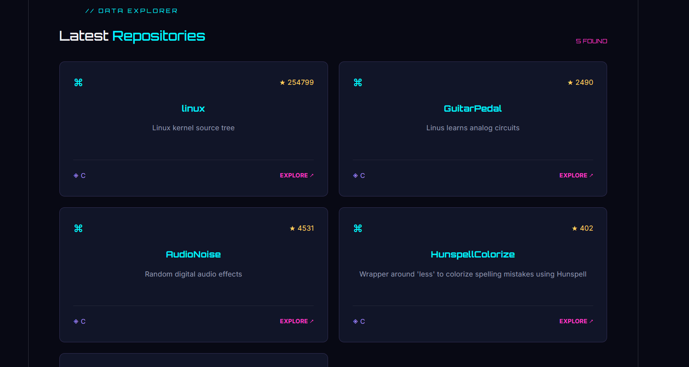

# 🚀 GitHub Profile Finder

A React-based application that allows users to search for GitHub profiles and explore their latest public repositories. Built with a cyberpunk-inspired interface.

## 📸 Screenshots

### Home Page


### Profile Search Results


## ✨ Features

- Search GitHub users by username
- Display profile picture and user information
- Show followers, following and public repositories
- Display the latest 5 repositories
- Show repository stars and programming languages
- Loading and error handling
- Responsive cyberpunk-inspired UI

## 🛠️ Tech Stack

- React
- JavaScript
- CSS
- GitHub REST API
- Vite

## ⚙️ Installation and Setup

Clone the repository:

```bash
git clone https://github.com/Faiz9994/github-profile-finder.git
```

Navigate to the project directory:

```bash
cd github-profile-finder
```

Install dependencies:

```bash
npm install
```

Start the development server:

```bash
npm run dev
```

## 🔗 API

This project uses the public GitHub REST API:

https://api.github.com/

## 👨‍💻 Author

**Faiz**

GitHub: https://github.com/Faiz9994